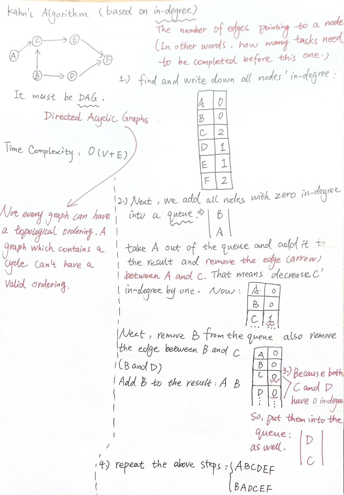

# GraphGuide-图知识指南
# 树是一种特殊的图（是一种连通、无环的无向图），但图不是一定是树
## 1. 图的基本概念

图通常记作 `G = (V, E)`：`V` 是顶点（Vertex）集合，`E` 是边（Edge）集合

- **顶点**：图中的对象
- **边**：顶点之间的关系，边可以*有方向*，也可以带*权值*
- **有向图 / 无向图**：有向边 `u → v` 只能从 `u` 到 `v`；无向边 `{u, v}` 表示两点互相连接
- **带权图 / 无权图**：边带有距离、花费等权值的图；未标权时通常把每条边权看作 `1`
- **邻接点**：与某顶点由一条边直接相连的顶点
- **度**：**无向图**中与顶点相连的边数：有向图分为入度（*进入*该点的边数）和出度（从该点*出去*的边数）
- **路径**：沿边从一个顶点到另一个顶点经过的顶点序列，路径长度可按边数或边权总和计算
- **环**：**起点和终点相同**的路径，没有环的图称为无环图
- **连通图**：**无向图**中任意两点之间都存在路径，若不连通，图由多个连通分量组成
- **强连通**：**有向图**中任意两点都能相互到达，最大强连通子图称为强连通分量（SCC）
- **稠密图 / 稀疏图**：边数接近顶点数平方的图称稠密图；边数较少、接近顶点数的图称稀疏图

#### 无向图的度数总和等于边数的两倍
#### 有向图所有顶点入度之和、出度之和都等于边数

---

## 2. 图的存储方式
- 邻接矩阵
- 邻接表
- 边列表

无向图在邻接表中要把一条边记录在两个端点的列表里；有向图只记录从起点出发的边

---

## 3. 图的遍历

### 深度优先搜索（DFS）

沿一条路径尽可能深入，再回退继续搜索（backtrack），可用递归（recursive）或显式栈（explicit stack）实现

DFS goes as far as it can down a given path,then backtrack until it finds another unexplored path and visit it.

#### Each vertex is visited only once!!!

*In BinaryTree's traversal,the result will be the unique(only one),but in Graph's tarversal,the result is NOT unique.And the results depend on the order we visit vertex's neighbors.* 二叉树的深度优先搜索结果是唯一的，但是图的深度优先搜索结果却是**不唯一**的，这取决于访问邻接点的次序如何

- 用**显示栈**实现图的DFS：DFS_stack/note.md
- 用**递归**实现图的DFS：DFS_recursive/note.md

### 广度优先搜索（BFS）

使用队列，按距离起点的边数一层层访问。适合无权图中的最短路、层级关系和最少步数问题

邻接表下，DFS 和 BFS 的时间复杂度都是 `O(V+E)`，空间复杂度为 `O(V)`。图可能不连通，因此若要遍历整张图，需要从每个尚未访问的顶点启动一次搜索

---

## 4. 最短路径

| 算法 | 使用条件 | 主要复杂度 | 说明 |
| --- | --- | --- | --- |
| BFS | 无权图，或所有边权相同 | `O(V+E)` | 求单源最少边数路径 |
| Dijkstra | 边权非负 | 邻接表加优先队列约 `O((V+E) log V)` | 贪心地确定当前最近的顶点；不能用于负权边 |
| Bellman-Ford | 可以有负权边 | `O(VE)` | 松弛所有边最多 `V-1` 轮；还能检测从源点可达的负权环 |
| Floyd-Warshall | 求所有点对最短路；通常图规模较小 | `O(V³)` 时间、`O(V²)` 空间 | 动态规划；可处理负边，但存在负权环时最短路无定义 |

---

## 5. 最小生成树-MST
克鲁斯卡尔算法是以边edge为突破点，而普里姆算法则是以顶点vertex为突破点
- **Kruskal（克鲁斯卡尔算法）**：边按权值从小到大排序，依次加入不会形成环的边。使用并查集判断两端是否已连通；复杂度通常为 `O(E log E)`
- **Prim（普里姆算法）**：从任意顶点开始，每次选择连接已选顶点集合与未选顶点的最小边扩展。配合优先队列时复杂度约为 `O((V+E) log V)`

**笔记见Graph文件夹下的minimum_spanning_tree文件里的note.png -> https://github.com/ElevenNie11/Awesome-DataStructure-Guide/blob/main/Graph/minimun_spanning_tree/note.jpg**

---

## 6. 拓扑排序-Topological ordering

拓扑排序只适用于有向无环图（DAG）

拓扑排序是DAG顶点的**线性顺序**，要求每条有向边 `u → v` 中，`u` 都排在 `v` 前面。常用于课程安排、构建依赖和任务调度。只有 DAG 才有拓扑序，结果可能不唯一。

#### 拓扑排序可能有多个结果

如下所示： A、B都要先于C，C要先于D，所以必须先完成A或者B，才可以完成C，而为了完成D，则必须先完成C，这就是拓扑排序！

那么一个合法顺序是 `A, B, C, D`；当然`B, A, C, D` 也合法，因为A和B之间没有先后限制

````
    A → C → D
    B ──┘
````

### Kahn算法实现拓扑排序
Kahn 算法通过顶点的入度逐步生成拓扑序列：
- 1. 统计每个顶点的入度，把入度为 0 的顶点加入队列
- 2. 每次从队列取出一个顶点，加入排序结果
- 3. 删除它指向其他顶点的边，并更新相邻顶点的入度；入度变为 0 时加入队列
- 4. 如果结果中的顶点数少于总数，说明图中有环，无法拓扑排序
- 时间复杂度为 **`O(V + E)`**



比如在上面的例子中，A、B的入度为0，先放入队列

处理完A、B后，C的入度变成0

处理C后，D的入度变成0，最终得到拓扑排序： A, B, C, D

如果最终排序结果的顶点数少于图中的顶点数，说明有些顶点的依赖始终无法解除，图中存在环，因此不存在拓扑排序