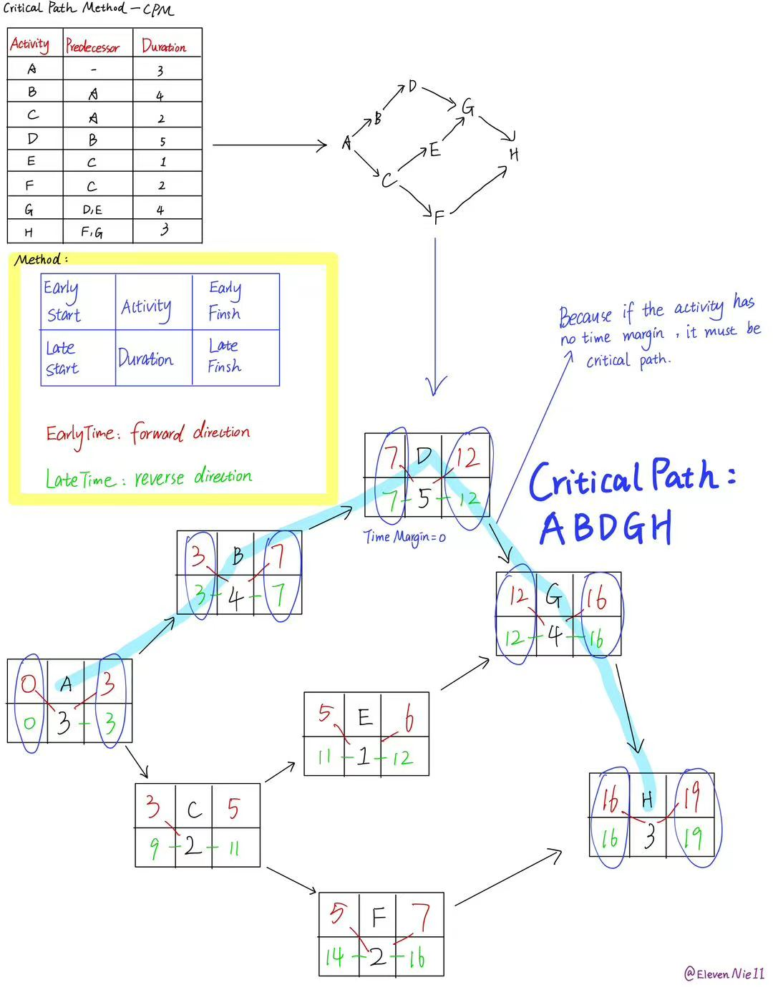

# 关键路径
## ✅#01. 关键路径是什么？
关键路径用于分析项目最短需要多久才能完成：关键路径是从起点到终点的**最长路径**（它和Dijkstra求的最短路径目标相反：关键路径求最长路径）

因为路径上的活动**必须依次完成**，它的总时长决定整个项目的工期，关键路径上的活动如果延误，项目通常也会跟着延误

通常用**AOE网**（Activity On Edge）表示项目：
- 顶点表示事件，例如“某阶段完成”
- 有向边表示活动，边权表示活动需要的时间
- 图必须是有向无环图（DAG）

---

## 📚#02. 关键路径算法（CPM）：拓扑排序-计算最早发生时间和最晚发生时间
### CPM利用图是有向无环图的特点，用动态规划求最长路径
设活动 u → v 的持续时间为 duration：
1. **正向**遍历拓扑序，计算事件**最早**发生时间：
   `ve[v] = max(ve[v], ve[u] + duration)`
2. **反向**遍历拓扑序，计算事件**最晚**发生时间（终点的最迟时间设为项目总工期）：
   `vl[u] = min(vl[u], vl[v] - duration)`
3. 判断关键活动：如果活动没有时间余量，它就是关键活动（**把关键活动连接起来，就得到关键路径**）：
   `ve[u] == vl[v] - duration`
4. 若拓扑排序无法处理所有顶点，说明图中有环

---

### 最早发生时间 & 最晚发生时间
在AOE网里，顶点表示事件，边表示需要时间的活动（**Activity On Edge**）
- 最早发生时间`ve[v]`：事件v最早什么时候能发生，**它必须等所有前置活动都完成**，所以取前置路线中最晚完成的时间

  `ve[v] = max(ve[u] + duration(u, v))`

- 最晚发生时间`vl[v]`：事件v最晚什么时候发生，才不会拖延整个项目，它要给后续活动留够时间，所以从终点往回算，取后续路线中允许时间最紧的那个

  `vl[u] = min(vl[v] - duration(u, v))`

例1：事件v有两项前置活动A和B，A最晚结束时间为10，B最晚结束时间为16，16 > 10，那么时间v的最早发生时间就应该是16

例2，事件v有两项前置活动C和D，C最晚发生时间为11，D最晚发生时间为14，11 < 14，那么事件v的最晚结束事件就应该是11

---

## 🚀#03. 关键路径需要什么？
### A critical path needs:
#### 1. The list of tasks
#### 2. Any task dependenies
#### 3. Duration of each task