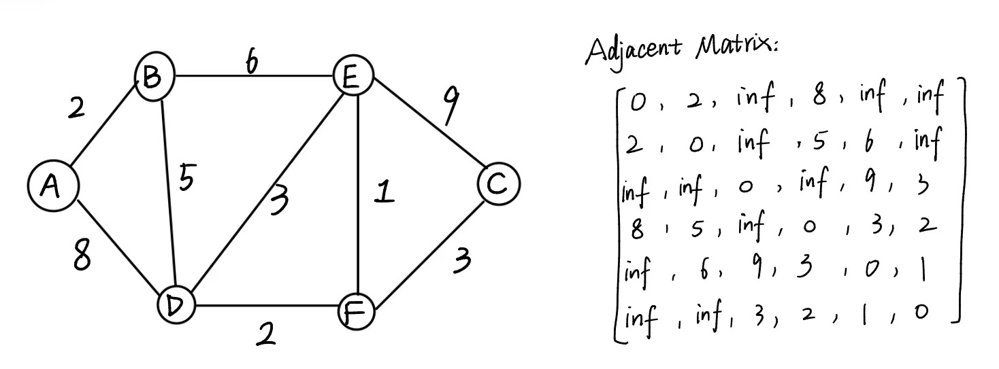
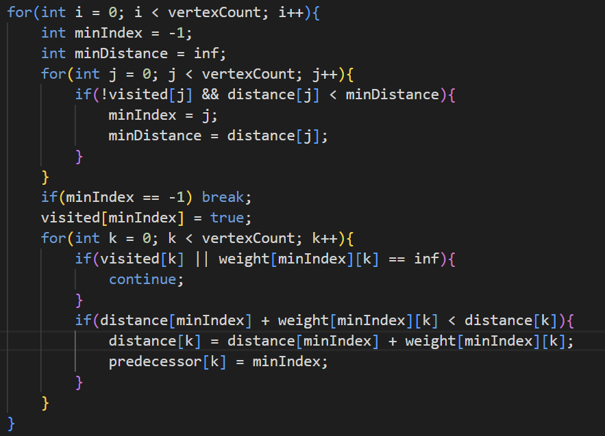

# Dijkstra-completing with adjacent matrix-code analysis
# 迪杰斯特拉-用邻接矩阵实现-代码分析
# 【图解过程】
## #01. 邻接矩阵 Adjacent Matrix


### 邻居都是有权重不为0且不为**inf**的，权重为0代表顶点它自己，权重为**inf**表示不是邻居

````java
        // 图的表示方法之一：邻接矩阵
        String[] vertices = {"A", "B", "C", "D", "E", "F"};
        int[][] weight = {
            {0, 2, inf, 8, inf, inf},
            {2, 0, inf, 5, 6, inf},
            {inf, inf, 0, inf, 9, 3},
            {8, 5, inf, 0, 3, 2},
            {inf, 6, 9, 3, 0, 1},
            {inf, inf, 3, 2, 1, 0}   
        };
````

---

## #02. 关键代码
### 图里有6个顶点，按邻接矩阵的行列顺序记为 A、B、C、D、E、F
### 我们以A为起点，来看代码每一轮如何选顶点、更新距离


### #02.1. 分解part1
```java
int minIndex = -1;
int minDistance = inf;
for(int j = 0; j < vertexCount; j++){
    if(!visited[j] && distance[j] < minDistance){
        minIndex = j;
        minDistance = distance[j];
    }
}
```
- `distance`记录从A出发目前找到的最短距离
- 刚开始，只有A到自己的距离是0；其他顶点还没有找到路线，暂记为`inf`
- 在 `for(int j = 0; j < vertexCount; j++)` 中，先从A出发，扫描所有未确定的顶点，选出暂定距离最小的顶点
- 第一轮选中A，因为`distance[A] = 0`，由于还没有B、D的`distance`的值，所以循环结束以后会把A标记成`visited[A] = true;`
- 接着`for(int k = 0; k < vertexCount; k++)`检查A的邻居：图中有 A—B（权重 2）和 A—D（权重 8）符合循环条件，于是更新：`distance[B] = 2`和`distance[D] = 8`

#### 然后又进入⚠️最外层循环⚠️，可以发现：在未确定的顶点中，当前距离最小的是B（距离为2）`minDistance = distance[B];`

---

### #02.2. 此时以B为出发点，分解part2
````java
if(minIndex == -1) break;
visited[minIndex] = true;
````
- 代码将B标记为`visited`，即：`visited[1] = true;`

---

### #02.3. 此时以B为出发点，分解part3
````java
for(int k = 0; k < vertexCount; k++){
    // visited[0] = visited[A] = true continue;
    // visited[1] = visited[B] = true countinue;
    // weight[1][2] == inf continue; （B、C不是邻居）
    // ...... 
    if(visited[k] || weight[minIndex][k] == inf){
            continue;
    }
    // (distance[1] + weight[1][3] = 7) < (distance[3] = 8)
    // distance[3] = 8 （即：distance[3] = distance[D] = 7）
    // 更新D
    if(distance[minIndex] + weight[minIndex][k] < distance[k]){
            distance[k] = distance[minIndex] + weight[minIndex][k];
            predecessor[k] = minIndex;
    }
}
    // 当 k = 4 时，来到E
    // weight[1][4] == 6
    // (distance[B] + weight[1][4] = 2 + 6 = 8) < (distance[4] = inf)
    // 更新E
````
- 通过B 到 D的路线长度是2 + 5 = 7，比当前的`distance[D] = 8`更短，所以更新D为7
- 通过B 到 E的路线长度是2 + 6 = 8，所以更新E为8