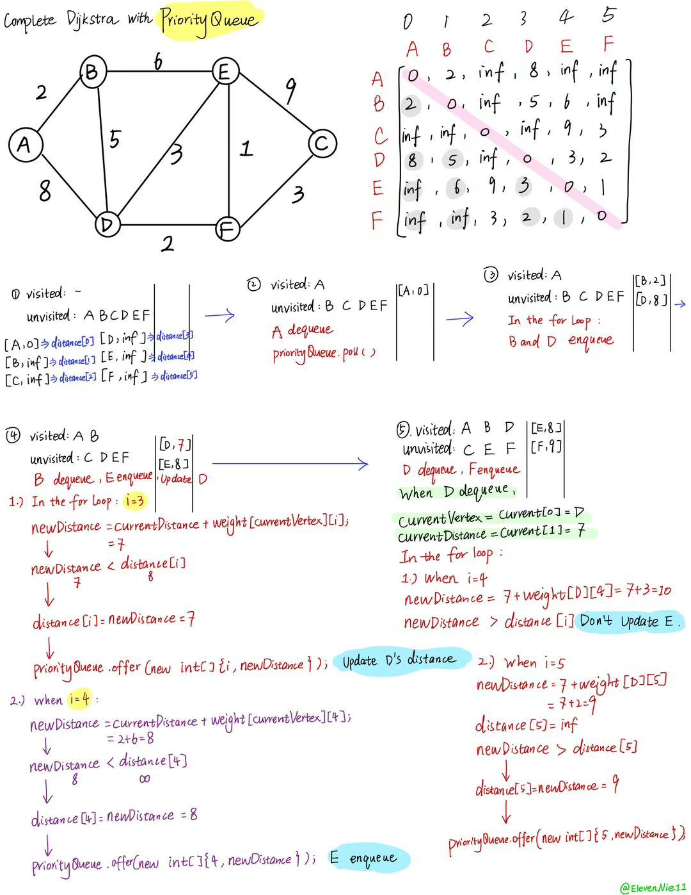
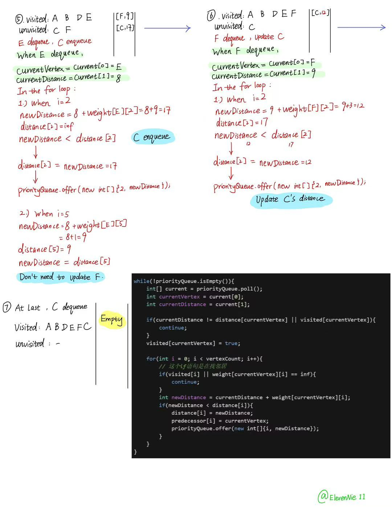

# Dijkstra-completing with Priority Queue-code analysis
# 迪杰斯特拉-用优先队列实现-代码分析
# 【图解过程】
## #01. 优先队列 Priority Queue

### part1-Java里的【优先队列】语法
````java
PriorityQueue<int[]> priorityQueue = new PriorityQueue<>((a, b) -> Integer.compare(a[1], b[1]));
````
这行代码创建了一个存放`int[]`的优先队列，并规定队列按数组的第2个元素（因为下标为1，所以是第2个元素）从小到大排列：
- `PriorityQueue<int[]>`：队列中存放的每个元素都是一个`int`数组
- `new PriorityQueue<>(...)`：创建优先队列，右边的`<>`会根据左边的类型推断出`int[]`
- `(a, b) -> ...`：Java的**Lambda**表达式，用来告诉队列怎样比较两个元素
- `Integer.compare(a[1], b[1])`：比较两个数组的下标1处的值，返回结果的规则是：
  - 小于 0：`a[1]` 较小
  - 等于 0：两者相等
  - 大于 0：`a[1]` 较大

---

### part2-本程序的约定：`new int[]{顶点编号, 当前距离}`
因此`a[1]`和`b[1]`比较的是当前距离

距离较小的数组会先从队列中取出，例如：
````java
priorityQueue.offer(new int[]{3, 8}); // 顶点3，距离8
priorityQueue.offer(new int[]{1, 2}); // 顶点1，距离2
````

---

### part3-主逻辑
````java
        // 每次取出当前距离起点最近的顶点
        while(!priorityQueue.isEmpty()){
            int[] current = priorityQueue.poll();// poll：从队头取出元素
            // 队列里存的每一个元素都是一个数组，然后这个数组内部又有两个元素current[0]是顶点，current[1]是距离
            int currentVertex = current[0];
            int currentDistance = current[1];    

            // 此时的最短距离不等于队头的距离或者已经被访问过，就continue
            // 优先队列的队头【永远是当前的最短距离】
            if(currentDistance != distance[currentVertex] || visited[currentVertex]){
                continue;
            }
            visited[currentVertex] = true;

            // 尝试经过当前顶点到达其他顶点，更新更短的距离
            for(int i = 0; i < vertexCount; i++){
                // 这个if语句是在找邻居
                if(visited[i] || weight[currentVertex][i] == inf){
                    continue;
                }
                // 计算新的距离
                int newDistance = currentDistance + weight[currentVertex][i];
                // 检查新距离是否比之前记录过的最短距离还短
                if(newDistance < distance[i]){
                    distance[i] = newDistance;      // 更新当前最短距离
                    predecessor[i] = currentVertex; // 更新前驱节点
                    priorityQueue.offer(new int[]{i, newDistance}); // 将更新后的距离放进优先队列，算法之后就能按距离从小到大继续处理它
                }
            }
        }
````

---

## #02. Hand-Written dequeue & enqueue process（手写出队&入队过程）




