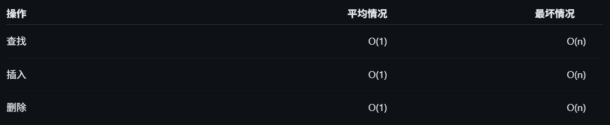

# 哈希映射-HashMap
### 以键值对(key-value)的形式存储数据，并通过键瞬间检索到对应的值（输入键，立刻得到值）
### 将键传入一个哈希函数Hash()（也叫哈希方法）：哈希函数的内部通过特定的数学公式将键计算为一串数字，这串数字指向内存中一个固定的槽位

---

## 简单介绍哈希映射HashMap（英文版）
### Hashmaps
We're going to talk about is the hashmap.And make sure you know this one. Please think of a hashmap like a mail room in an office where every employee
has a dedicated mailbox. Instead of sorting through all the mail one by one, you just look: oh, John! His mailbox is number four. Sally, her mailbox is number five, you know exactly where to put it, and John and Sally know exactly where to access it.

A hashmap stores data using *key value pairs* where each key is run through a hash function that determines where the value should be stored. An example of a hash function could be the length of a string, so John's name for example is four characters long so he's in position four, Sally is in position five, her name is five characters long.This makes lookups on hashmaps extremely efficient, time complexity wise being O(1).

However, if too many items hash to the same mailbox, which we call a **hash collision**. For example if a new employee Andy joins, well his name is also four letters, we can't just put him in position number four because that's where John is.

So we need to have a hash collision resolution, which could be a **linked list chaining(链地址法)** from the hashmap position, or it could be **linear probing(线性探测法)** where you find the next available position. Either way this is the only real downside to hashmaps, otherwise they are super efficient as a data structure.

So overall, accessing an element by its key in a hashmap is an O(1) operation, but it could be **O(n) worst case** if everything is put into that linked list and you have to do a lot of searching. Inserting an element is an O(1) operation, but worst case scenario that could end up being O(n).
Deleting an element is also an O(1) operation because if you have the right key you can just go to the value, but if there is a long linked list that you have to deal with to find the actual real element, that could end up being an O(n) operation.

By the way, if you use Python you probably call hashmaps dictionaries, but they're pretty much the same thing.

### Time Complexity


---

## Java示例

### Java中使用`HashMap`和`HashSet`
````java
import java.util.HashMap; // 接口
import java.util.HashSet; // 接口
import java.util.Map;     // 具体实现类
import java.util.Set;     // 具体实现类

Map<String, Integer> scores = new HashMap<>();
scores.put("小林", 95);
scores.put("小周", 88);

int score = scores.get("小林");      // 查找
boolean hasKey = scores.containsKey("小周");

Set<String> names = new HashSet<>();
names.add("小林");
names.add("小林");                    // 重复元素不会被重复保存
boolean exists = names.contains("小林");
````
- `HashMap<K, V>`：根据键查找对应的值
- `HashSet<E>`：保存不重复的元素
- `HashSet`的元素唯一性依赖元素正确实现`equals()`和`hashCode()`

### Java自定义键：正确实现`equals()`和`hashCode()`
````java
import java.util.Objects;

public class StudentKey{
    private final String school;
    private final int studentId;

    public StudentKey(String school, int studentId){
        this.school = school;
        this.studentId = studentId;
    }

    @Override
    public boolean equals(Object obj){
        if(this == obj){
            return true;
        }
        if(!(obj instanceof StudentKey)){
            return false;
        }

        StudentKey other = (StudentKey) obj;
        return studentId == other.studentId && Objects.equals(school, other.school);
    }

    @Override
    public int hashCode(){
        return Objects.hash(school, studentId);
    }
}
````