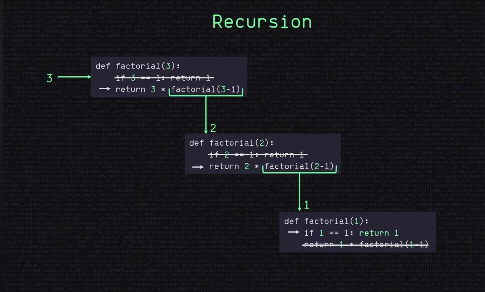
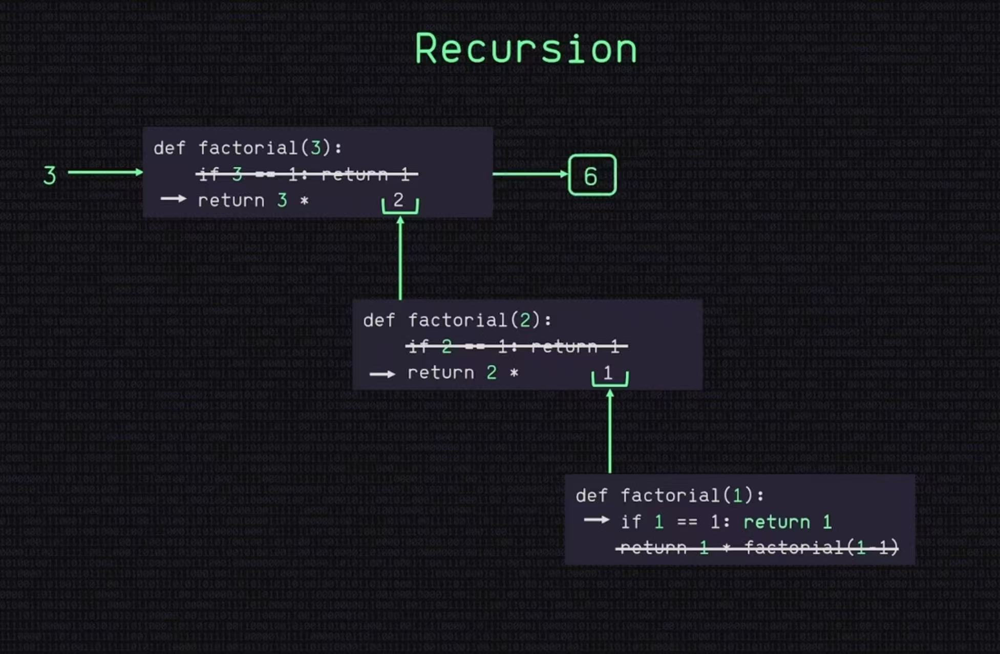

# 递归笔记-Recursion

## 递归调用会用到栈

在`DepthFirstSearch_recursive.java`程序中，每次调用`DFS(neighbor)`，Java运行时都会把这次调用的信息（参数、局部变量、返回位置等）放到**调用栈**里

递归返回时，再从调用栈中取出上一层调用，继续处理剩下的邻居

### 【区分】
- 递归DFS`DepthFirstSearch_recursive.java`：使用Java自动管理的调用栈
- 迭代DFS`DepthFirstSearch_stack.java`：在代码里显式创建`Deque`等结构来模拟栈
- 递归层数太深时，调用栈空间可能耗尽，出现*StackOverflowError*

#### 【迭代iterative】
迭代就是用**循环反复执行**一段代码，直到满足结束条件

常见的`for`和`while`循环都是迭代

---
## 两张图搞懂【阶乘】的递归思想





---

## 递归程序举例
### 【例1-斐波那契】
- 斐波那契数列：1 1 2 3 5 8 13 21...

第n个斐波那契数的计算公式：`F(n) = F(n - 1) + F(n - 2)`

递归的关键是两个**结束条件**：`n == 0` 和 `n == 1`
````
    // 递归计算第n个斐波那契数
    public static long fibo(int n){

        if(n == 0){
            return 0;
        }

        if(n == 1){
            return 1;
        }

        return fibo(n - 1) + fibo(n - 2);
    }
````

### 【例1 递归流程】

函数不断把较大的问题拆成两个较小的问题，直到遇到 `n == 0` 或 `n == 1`，返回 0 或 1，然后这些结果**逐层返回并相加**（回溯）
