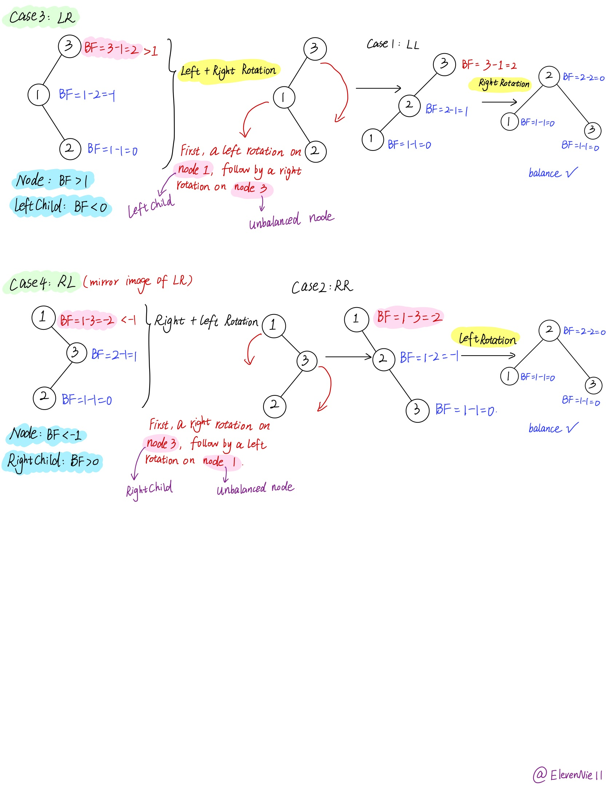
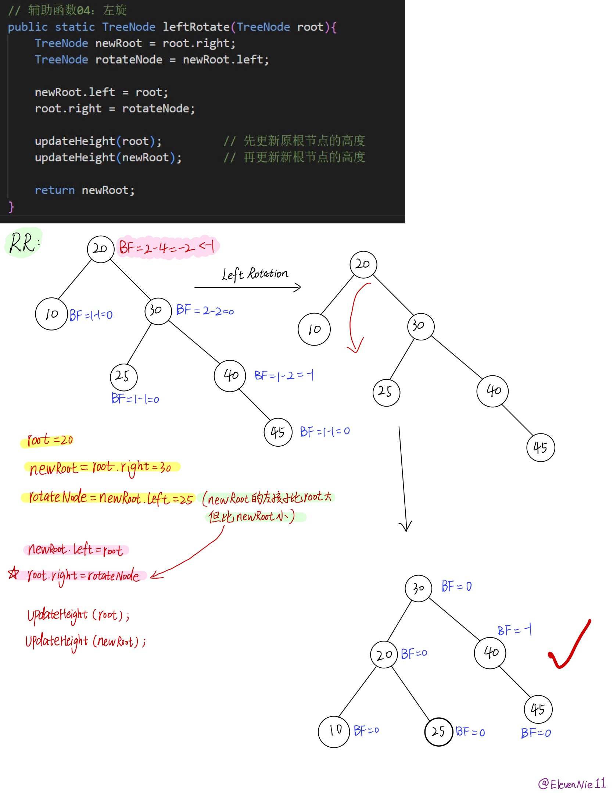

# 平衡二叉树（又称：AVL树）
### 若二叉搜索树BST中的每个节点的左右子树高度之差的绝对值不超过1，则称其为平衡二叉树（也称：AVL树）
---
# 📚【Properties】: BST + Balance Factor ∈ [-1, 0, 1]
## AVL树的2个【必备概念】：树高TreeHeight + 平衡因子BalanceFactor


---

# 🚀插入：平衡旋转技术
## ✅4种【不平衡】情况以及解决方案（LL、RR、LR、RL）
### If the tree becomes unbalanced,we fix it using rotation.

### ✏️Hand-Writen Note



---

## 📒【总结】LL RR LR RL
### BF = 左子树高度 - 右子树高度
- `BF > 1`：当前节点的左子树过高
- `BF < -1`：当前节点的右子树过高

---

- **LL**：左子树的左侧过高，做一次**右旋**
- **RR**：右子树的右侧过高，做一次**左旋**
- **LR**：左子树的右侧过高，先对**左孩子左旋**，再对**失衡节点右旋**
- **RL**：右子树的左侧过高，先对**右孩子右旋**，再对**失衡节点左旋**

这里的“高”是指新插入节点后，某个节点的一侧子树比另一侧高太多

---

## 🚀【示例】

````
LL：依次插入 5、3、1       RR：依次插入 1、3、5

      5                         1
     /                           \
    3                             3
   /                               \
  1                                 5
````
- **LL**：从失衡节点 5 先往左到 3，再往左到 1（左子树的左侧过高，做一次**右旋**）
- **RR**：从 1 先往右到 3，再往右到 5（右子树的右侧过高，做一次**左旋**）

````
LR：依次插入 5、1、3       RL：依次插入 1、5、3

      5                         1
     /                           \
    1                             5
     \                           /
      3                         3
````
- **LR**：从 5 往左到 1，再往右到 3（左子树的右侧过高，先对**左孩子左旋**，再对**失衡节点右旋**）
- **RL**：从 1 往右到 5，再往左到 3（右子树的左侧过高，先对**右孩子右旋**，再对**失衡节点左旋**）

---



---

## Q: 为什么要先更新原节点的高度，再更新新节点的高度？
## A：因为旋转后，新根的高度要用到原节点更新后的高度
左旋后，原节点`root`下沉，成为新根`newRoot`的左孩子，高度计算关系是：
````java
root.height = max(root.left.height, root.right.height) + 1
newRoot.height = max(newRoot.left.height, newRoot.right.height) + 1
````
而`newRoot.left`就是`root`，因此要先更新`root.height`，再用这个新高度计算`newRoot.height`

---

## 💻【代码】-关键逻辑
### BF = 左子树高度 - 右子树高度

````java
// 【不平衡的4种情况】
// AVL树的前提之一是它是一棵BST
// LL：左子树的左侧过高，进行一次右旋
if(BF > 1 && value < root.left.value){
      return rightRotate(root);
}
// RR：右子树的右侧过高，进行一次左旋
if(BF < -1 && value > root.right.value){
      return leftRotate(root);
}
// LR：左子树的右侧过高，先左旋再右旋
if(BF > 1 && value > root.left.value){
      root.left = leftRotate(root.left);    // 先对左孩子左旋
      return rightRotate(root);             // 再对失衡节点右旋
}
// RL：右子树的左侧过高，先右旋再左旋
if(BF < -1 && value < root.right.value){
      root.right = rightRotate(root.right); // 先对右孩子右旋
      return leftRotate(root);             // 再对失衡节点左旋
}
````
### BF = 左子树高度 - 右子树高度
- `BF > 1`：当前节点的左子树过高
- `BF < -1`：当前节点的右子树过高
- `value`是刚插入的新值：把它和对应孩子的值比较

---

| 条件 | 判断路径 | 类型 | 调整 |
|---|---|---|---|
| `BF > 1 && value < root.left.value` | 向左，再向左 | LL | 对当前节点右旋 |
| `BF > 1 && value > root.left.value` | 向左，再向右 | LR | 左孩子左旋，再当前节点右旋 |
| `BF < -1 && value > root.right.value` | 向右，再向右 | RR | 对当前节点左旋 |
| `BF < -1 && value < root.right.value` | 向右，再向左 | RL | 右孩子右旋，再当前节点左旋 |