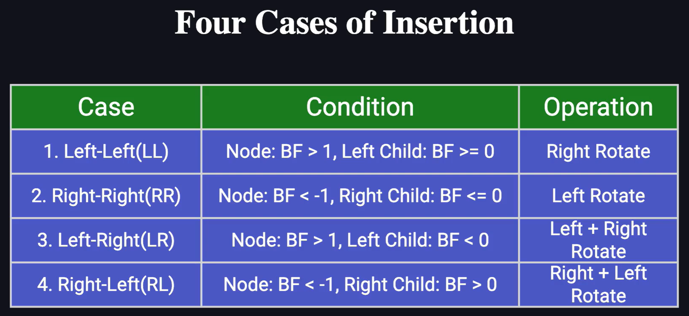
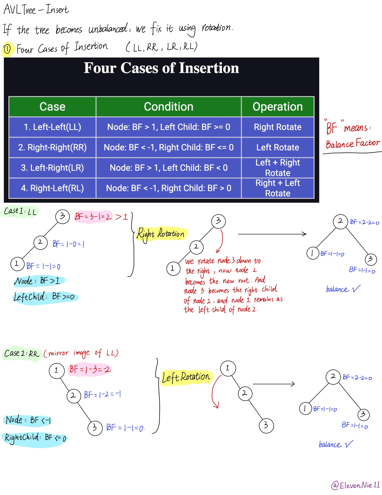

# 平衡二叉树（又称：AVL树）
### 若二叉搜索树BST中的每个节点的左右子树高度之差的绝对值不超过1，则称其为平衡二叉树（也称：AVL树）
---
# 📚【Properties】: BST + Balance Factor ∈ [-1, 0, 1]
## AVL树的2个【必备概念】：树高TreeHeight + 平衡因子BalanceFactor


---

# 🚀插入：平衡旋转技术
## ✅4种【不平衡】情况以及解决方案（LL、RR、LR、RL）
### If the tree becomes unbalanced,we fix it using rotation.

### ✏️Hand-Writen Note



---

## 📒【总结】LL RR LR RL
- **LL**：左子树的左侧过高，做一次右旋
- **RR**：右子树的右侧过高，做一次左旋
- **LR**：左子树的右侧过高，先对左孩子左旋，再对失衡节点右旋
- **RL**：右子树的左侧过高，先对右孩子右旋，再对失衡节点左旋

这里的“高”是指新插入节点后，某个节点的一侧子树比另一侧高太多

从这个失衡节点开始，沿着通往新节点的路径看方向：第一个方向表示左或右子树，第二个方向表示那棵子树内部的左或右侧

````
LL：依次插入 5、3、1       RR：依次插入 1、3、5

      5                         1
     /                           \
    3                             3
   /                               \
  1                                 5
````
- **LL**：从失衡节点 5 先往左到 3，再往左到 1（左子树的左侧过高，做一次**右旋**）
- **RR**：从 1 先往右到 3，再往右到 5（右子树的右侧过高，做一次**左旋**）

````
LR：依次插入 5、1、3       RL：依次插入 1、5、3

      5                         1
     /                           \
    1                             5
     \                           /
      3                         3
````
- **LR**：从 5 往左到 1，再往右到 3（左子树的右侧过高，先对**左孩子左旋**，再对**失衡节点右旋**）
- **RL**：从 1 往右到 5，再往左到 3（右子树的左侧过高，先对**右孩子右旋**，再对**失衡节点左旋**）