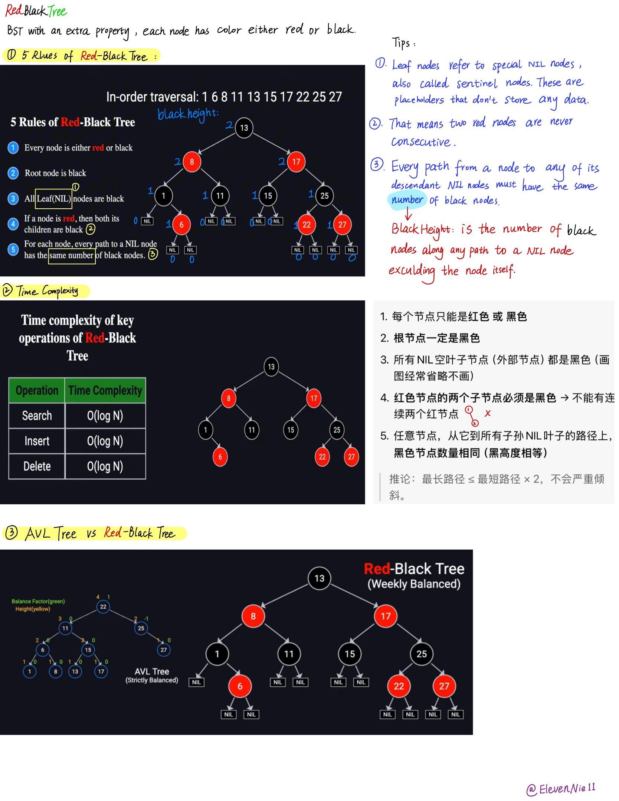

# 红黑树 Red-Black Tree
## 红黑树是一种 Weakly Binary Search Tree  |  AVL树是一种 Strictly Binary Search Tree


---

## 🚨【关键】Rotation


---

## 🚀插入insert
### 【总结】插入的4种情况


---

## 💻【修复平衡】代码
#### 在修复过程中我们会使用到失衡节点的【uncle parent grandparent】
#### 修复操作有两个：【recolor和rotate】
#### 场景1：uncle是红的                      -> 只变色（recolor），冲突上移到祖父
#### 场景2：uncle是黑的，且是"折线"(triangle) -> 先旋转parent，把折线掰成直线（再进行场景3）
#### 场景3：uncle是黑的，且是"直线"(line)     -> 先旋转祖父(rotate)，再变色(recolor)
#### 🚨【注意】：场景2和场景3是连招，掰直之后必须接着做场景3
````java

````