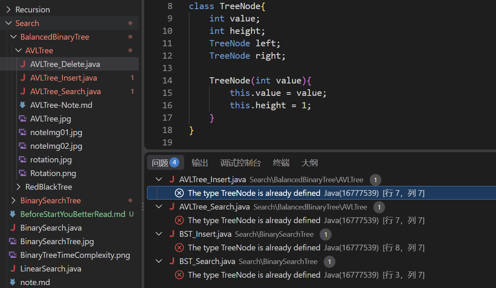

# 声明-无伤大雅
## 在【Search查找】中，为了方便大家学习，作者在多个文件里都重复定义了`TreeNode`
### 这在代码编辑器中会引起报错，所以你可以将每个`TreeNode`都改为每个文件自身的静态类(`static class TreeNode`)
````java
// 示例
public class AVLTree_Insert{
    // 静态类
    static class TreeNode{
        int value;
        int height;
        TreeNode left;
        TreeNode right;

        TreeNode(int value){
            this.value = value;
            this.height = 1;
        }
    }
}
````
## 【报错】同一个Java包里有多个文件都定义了顶层类`TreeNode`
