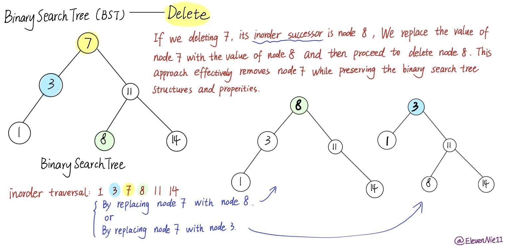
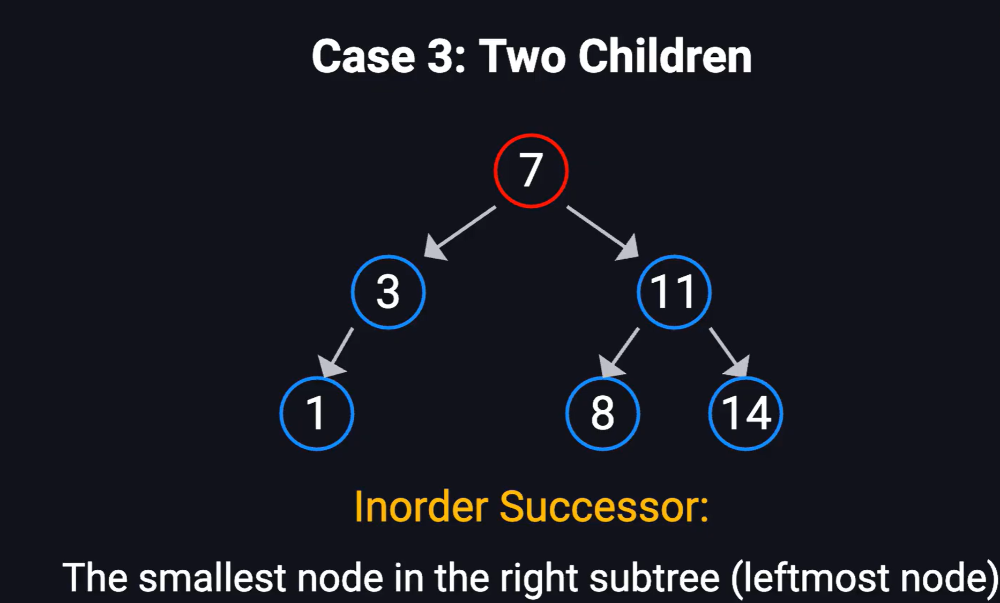
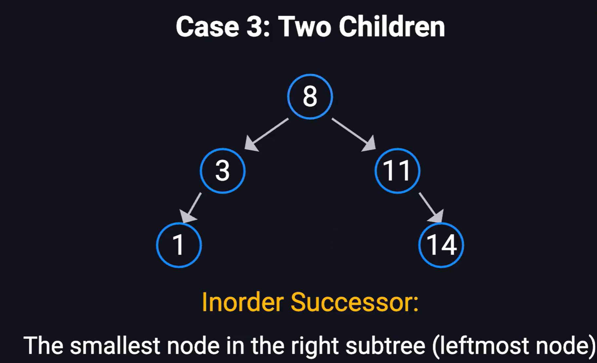
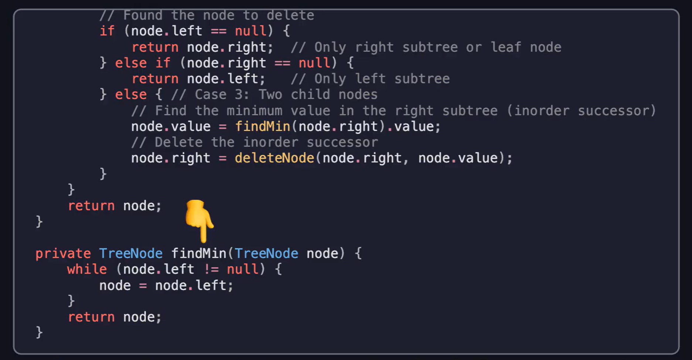

# BST-【删除】
### 目标节点就是要被删除的节点
## Case03：目标节点既有左子树又有右子树
## 【注意】删除目标节点之后不能破坏BST的规则

---

## 【图解过程】


- before:

- after:



---

## Java代码实现

````java
// 情况03：目标节点有左、右子树
// 找到右子树中最小的节点
TreeNode sucessor = root.right;
while(sucessor.left != null){
    sucessor = sucessor.left;
}
root.value = sucessor.value;
root.right = Delete_recursion(root.right, sucessor.value);
````
