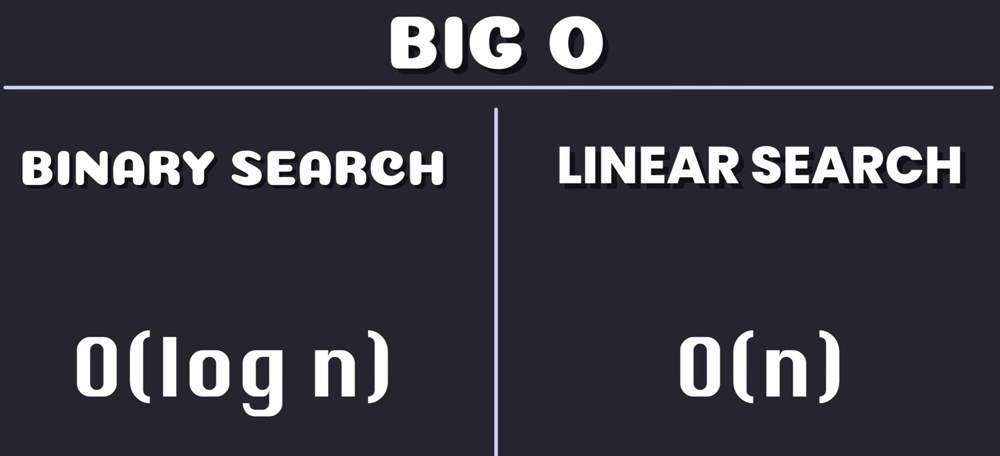

# 数据结构 - 查找Search 【静态查找 + 动态查找】

## #Chapter01.【静态查找】-顺序查找-LinearSearch
遍历数组，找到目标值，返回下标

---

## #Chapter02.【静态查找】-二分查找-BinarySearch
### 时间复杂度-TimeComplexity

### 二分查找需要具备的【条件】-Conditions
- RandomAccess.(Array✅ | LinkedList❌)
- The elements must be sorted.
  - `1 10 15 21 34 52 60 71 83` ✅
  - `1 15 10 83 34 52 71 50 21` ❌
### Q：中间位置的下标是怎么计算的？数组中有奇数个元素时下标怎么计算？有偶数个元素时下标又是怎么计算的？
````java
int mid = left + (right - left) / 2;
// 中间位置通常写成：
int mid = (left + right) / 2;
// 为了避免 left + right 相加得到的整数太大而溢出，把它改写成等价形式：
int mid = left + (right - left) / 2; ✅
// 推演过程：
(left + right) / 2
= (left + right - left + left) / 2
= (2 * left + right - left) / 2
= left + (right - left) / 2
// 当然如果确保 left + right 不会溢出，也可以用 mid = (left + right) / 2;
````
#### Java的整数除法会舍去小数部分，所以当查找范围有偶数个元素时，【取中间偏左】的那个位置
- **奇数**个元素：例如下标 0 到 4，共有 5 个元素，`mid = 0 + (4 - 0) / 2 = 2`，取正中间的下标 2
- **偶数**个元素：例如下标 0 到 3，共有 4 个元素，`mid = 0 + (3 - 0) / 2 = 1`，取偏左的中间下标 1

---

## #Chapter03.【动态查找】-二叉搜索树-BinarySearchTree
### BST可用操作：查找Search / 插入Insert / 删除Delete
也叫“二叉查找树”


---

## #Chapter04.【动态查找】-平衡二叉树-BalancedBinaryTree
- AVL树
- 红黑树