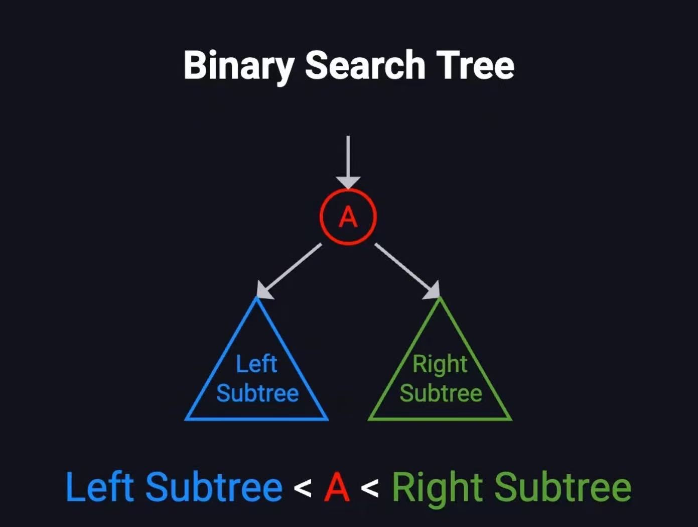
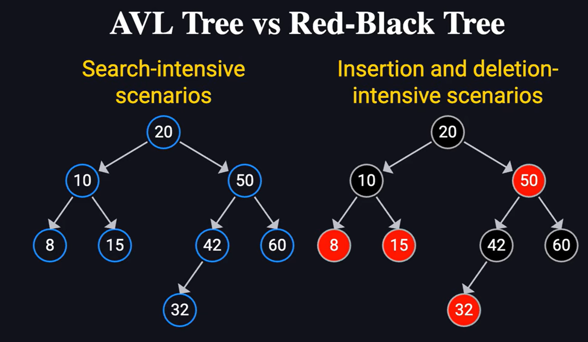

# 数据结构 - 查找Search 【静态查找 + 动态查找】

## #Chapter01.【静态查找】-顺序查找-LinearSearch
遍历数组，找到目标值，返回下标

---

## #Chapter02.【静态查找】-二分查找-BinarySearch
### 时间复杂度-TimeComplexity

### 二分查找需要具备的【条件】-Conditions
- RandomAccess.(Array✅ | LinkedList❌)
- The elements must be sorted.
  - `1 10 15 21 34 52 60 71 83` ✅
  - `1 15 10 83 34 52 71 50 21` ❌
### Q：中间位置的下标是怎么计算的？数组中有奇数个元素时下标怎么计算？有偶数个元素时下标又是怎么计算的？
````java
int mid = left + (right - left) / 2;
// 中间位置通常写成：
int mid = (left + right) / 2;
// 为了避免 left + right 相加得到的整数太大而溢出，把它改写成等价形式：
int mid = left + (right - left) / 2; ✅
// 推演过程：
(left + right) / 2
= (left + right - left + left) / 2
= (2 * left + right - left) / 2
= left + (right - left) / 2
// 当然如果确保 left + right 不会溢出，也可以用 mid = (left + right) / 2;
````
#### Java的整数除法会舍去小数部分，所以当查找范围有偶数个元素时，【取中间偏左】的那个位置
- **奇数**个元素：例如下标 0 到 4，共有 5 个元素，`mid = 0 + (4 - 0) / 2 = 2`，取正中间的下标 2
- **偶数**个元素：例如下标 0 到 3，共有 4 个元素，`mid = 0 + (3 - 0) / 2 = 1`，取偏左的中间下标 1

---

## #Chapter03.【动态查找】-二叉搜索树-BinarySearchTree
### BST可用操作：查找Search / 插入Insert / 删除Delete
#### 【删除】操作的详细笔记可见👉[delete-note](https://github.com/ElevenNie11/Awesome-DataStructure-Guide/blob/main/Search/BinarySearchTree/delete-note.md)
也叫“二叉查找树”


---

## #Chapter04.【动态查找】-平衡二叉树-BalancedBinaryTree
- AVL树（查找/插入/删除）👉 [AVL树](https://github.com/ElevenNie11/Awesome-DataStructure-Guide/tree/main/Search/BalancedBinaryTree/AVLTree)
- 红黑树（查找/插入/删除）👉[红黑树](https://github.com/ElevenNie11/Awesome-DataStructure-Guide/tree/main/Search/BalancedBinaryTree/RedBlackTree)


## ✅旋转Rotation-AVL树和红黑树的辅助函数的差别
### 01.AVL树
````java
    // 辅助函数04：左旋
    // 形参root其实是【当前子树的根，不是整棵树的根】
    // newRoot是要上位的右孩子
    // rotateNode是要过继的【上位右孩子的左子树】（中间子树）
    public static TreeNode leftRotate(TreeNode root){
        TreeNode newRoot = root.right;
        TreeNode rotateNode = newRoot.left;     

        newRoot.left = root;     // 新根认旧根做左孩子
        root.right = rotateNode; // 旧根的右孩子改成过继的中间子树   

        updateHeight(root);         // 先更新原根节点的高度
        updateHeight(newRoot);      // 再更新新根节点的高度

        return newRoot;
    }

    /*-------------------------------------------------------------*/

    // 左旋转：返回旋转后该子树的新根
    //        node                      right
    //       /    \                    /     \
    //      a    right     --->      node     c
    //           /   \              /   \
    //          b     c            a     b
    public static TreeNode leftRotate(TreeNode node){
        // 01. 先把要node的右孩子存下来，后面node.right会被改掉
        TreeNode right = node.right;
        // 02. 把right的左子树b过继给node当右子树（b的取值正好落在node与cs之间）
        node.right = right.left;
        // 03. 父子关系反转，node降为【right的左孩子
        right.left = node;
        // 04. 先更新原根节点的高度，再更新新根节点的高度
        updateHeight(node);
        updateHeight(right);
        // 05. 把新的子树根交还给调用方
        return right;
    }
````

---

### 02.红黑树
````java
    // 左旋
    //        node                      right
    //       /    \                    /     \
    //      a    right     --->      node     c
    //           /   \              /   \
    //          b     c            a     b
    public static TreeNode leftRotate(TreeNode node, TreeNode root){
        if(node == null || node.right == null){
            return root;
        }
        TreeNode right = node.right;   // 先把node的右孩子存下来，因为下一步node.right就被改掉了
        node.right = right.left;       // 把right的左子树b过继给node当右子树（b的取值正好落在node与right之间）
        if(right.left != null){
            right.left.parent = node;  // b原来认right做父亲，现在改认node
        }
        right.parent = node.parent;    //  让right顶替node原来的位置，先接好它和"祖父"这一头
        if(node.parent == null){
            // node本来就是根，right上位后成为新的根
            root = right;
        }else if(node == node.parent.left){
            // node原本是左孩子，那么right也挂到左边
            node.parent.left = right;
        }else{
            // node原本是右孩子，那么right也挂到右边
            node.parent.right = right;
        }

        // 最后把父子关系反转，node成为right的左孩子
        right.left = node;
        node.parent = right;

        return root;
    }
````