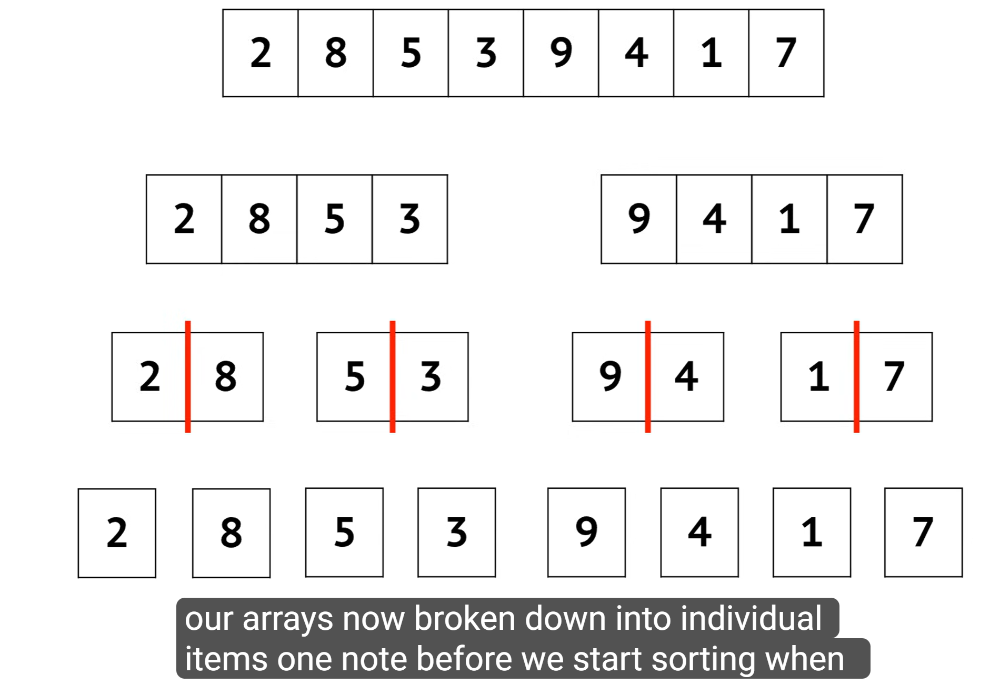
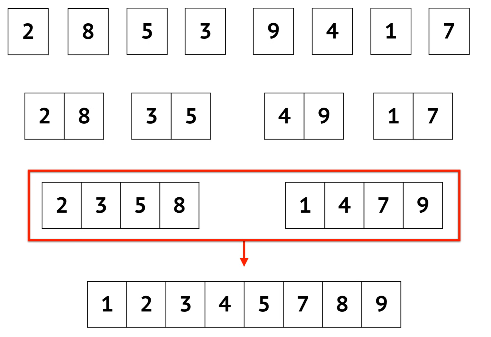
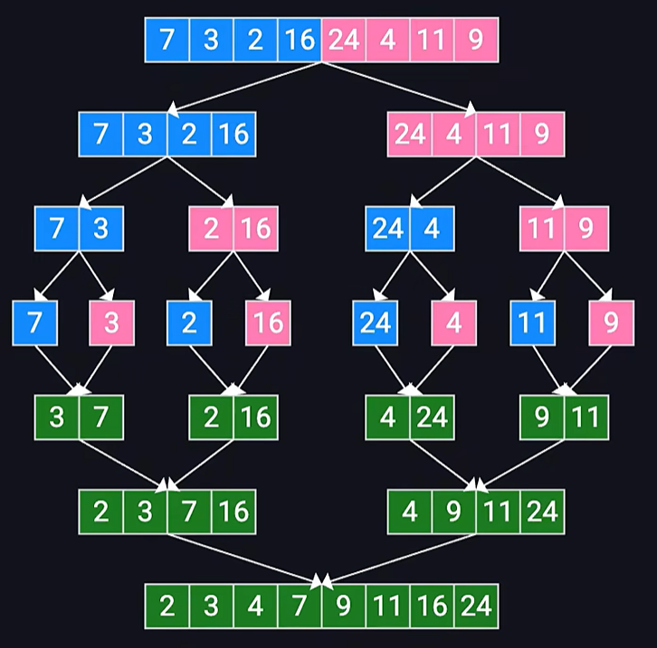
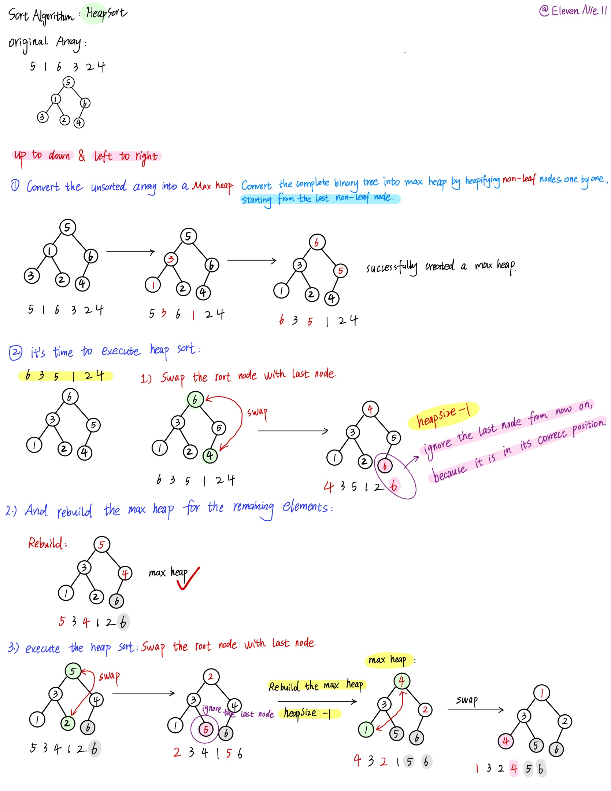
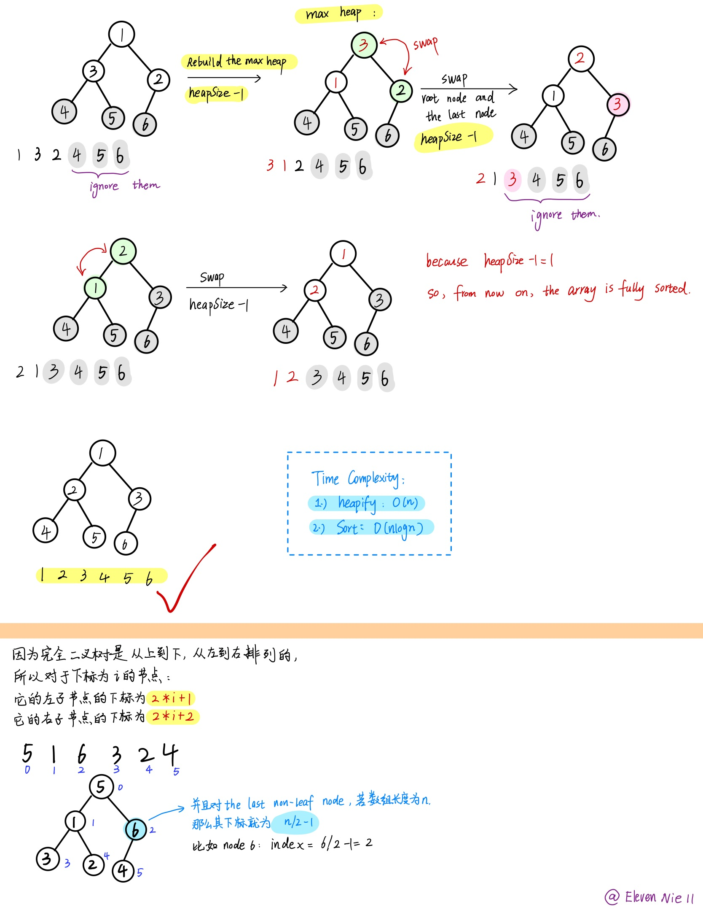

# 排序算法
## #01. 比较排序：通过比较元素大小来决定顺序

| 算法 | 平均时间 | 最坏时间 | 稳定性 | 特点 |
|---|---:|---:|---|---|
| [冒泡排序](BubbleSort.java) | O(n²) | O(n²) | 稳定 | 相邻元素比较并交换，适合理解排序过程 |
| [选择排序](SelectionSort.java) | O(n²) | O(n²) | 不稳定 | 每轮选出最小元素，交换次数较少 |
| [插入排序](InsertionSort.java) | O(n²) | O(n²) | 稳定 | 逐个把元素插入已排序部分；数据量小或基本有序时表现不错 |
| [希尔排序](ShellSort.java) | 依赖增量序列 | 通常 O(n²) | 不稳定 | 插入排序的改进版，先比较距离较远的元素 |
| [归并排序](MergeSort.java) | O(n log n) | O(n log n) | 稳定 | 分治后合并；通常需要 O(n) 额外空间 |
| [快速排序](QuickSort.java) | O(n log n) | O(n²) | 不稳定 | 平均速度快；选取枢轴不佳时可能退化 |
| [堆排序](HeapSort.java) | O(n log n) | O(n log n) | 不稳定 | 利用堆选取最大或最小元素；通常可原地排序 |

---

### 归并排序-Merge Sort
- #### usually done recursively.
- #### divide & conquer.

then:


### 递归过程
````java
// Recursively sort the left and right halves.
mergeSort(left);
mergeSort(right);
// Merge two sorted halves.
Merge(arr, left, right);
````
- 可以把递归过程记成：先一路拆分左边，左边处理完再拆分右边
- 两边都处理完，才在当前层合并`Merge(arr, left, right);`
- 每次递归调用都有自己的`arr`、`left`和`right`局部变量
- 调用深入时，Java会暂存当前层的位置；子调用返回后，再从原来的位置继续执行
#### Q:这个递归是怎么回事？走到`mergeSort(left);`的时候就一直是left数组在进行递归了吗？等待left递归完毕之后，再进行right数组的递归？
**A**：是的，`mergeSort(left)`会先把左半部分递归处理到底：等它整个调用完成并返回到第一次调用的位置，程序才执行`mergeSort(right)`，Java的方法调用是顺序执行的，**不会同时处理左右两边**

---

````java
#1  mergeSort([7,3,2,16 | 24,4,11,9])          深度1
    │
    ├── #2  mergeSort([7,3,2,16])              深度2   ← #1 的 left
    │      │
    │      ├── #3  mergeSort([7,3])            深度3   ← #2 的 left
    │      │      ├── #4  mergeSort([7])       深度4   ← 长度1，立即 return
    │      │      ├── #5  mergeSort([3])       深度4   ← 长度1，立即 return
    │      │      └── Merge([7,3],[7],[3])   → [3,7]        ⭐第一次合并
    │      │
    │      ├── #6  mergeSort([2,16])           深度3   ← #2 的 right
    │      │      ├── #7  mergeSort([2])       深度4   ← return
    │      │      ├── #8  mergeSort([16])      深度4   ← return
    │      │      └── Merge([2,16],[2],[16]) → [2,16]      ⭐第二次合并
    │      │
    │      └── Merge([7,3,2,16],[3,7],[2,16])→ [2,3,7,16]  ⭐第三次合并
    │
    ├── #9  mergeSort([24,4,11,9])             深度2   ← #1 的 right
    │      │
    │      ├── #10 mergeSort([24,4])           深度3
    │      │      ├── #11 mergeSort([24])      深度4   ← return
    │      │      ├── #12 mergeSort([4])       深度4   ← return
    │      │      └── Merge([24,4],[24],[4]) → [4,24]      ⭐第四次
    │      │
    │      ├── #13 mergeSort([11,9])           深度3
    │      │      ├── #14 mergeSort([11])      深度4   ← return
    │      │      ├── #15 mergeSort([9])       深度4   ← return
    │      │      └── Merge([11,9],[11],[9]) → [9,11]      ⭐第五次
    │      │
    │      └── Merge([24,4,11,9],[4,24],[9,11]) → [4,9,11,24] ⭐第六次
    │
    └── Merge(root,[2,3,7,16],[4,9,11,24]) → [2,3,4,7,9,11,16,24] ⭐第七次
````

---

### 快速排序-Quick Sort
- Lomuto分区法是一种快速排序中划分数组的方法：它选一个元素作为基准值（**pivot**），把小于或等于基准值的元素移到左边，把大于基准值的元素留在右边，最后把基准值放到中间的正确位置
- 快速排序的要点：**分区 + 交换 + 递归**

---

### 堆排序-Heap Sort
#### 🚀先调整较低层的父节点，再调整更高层的父节点，因为这样轮到某个父节点时，它的子树已经整理好了



数组用来表示二叉堆时，下标为 i 的节点：
- 左子节点下标是 **2 * i + 1**
- 右子节点下标是 **2 * i + 2**
对于长度为 n 的数组，堆大小为heapSize = n ，`heapSize / 2 - 1` 是最后一个有叶子节点的节点，它后面的节点都是叶子节点不需要调整（叶子节点没有子节点）
````java
// 构筑最大堆
for(int i = heapSize / 2 - 1; i >= 0; i--){
    heapify(arr, heapSize, i);      // 调用一次只能调整这个节点及其子树，其他父节点可能仍然不满足最大堆规则，所以要套在循环里面
}
````

最大堆的根节点，也就是`arr[0]`，总是当前堆中最大的值
````java
// 把根节点和最后一个节点交换
for(int i = heapSize - 1; i > 0; i--){
    swap(arr, 0, i);
    heapify(arr, i, 0);
}
````
每轮循环会：
1. 把根节点和当前堆末尾`arr[i]`交换，最大值就放到了数组末尾
2. 把堆的有效范围缩小到 i，**末尾已排好序的最大值不再参与堆操作**
3. 从根节点调用heapify，恢复剩余部分的最大堆性质

---

## #02. 非比较排序：利用键值范围、位数或分布特征进行排序，不通过逐对比较来决定顺序
| 算法 | 常见时间复杂度 | 适用条件 |
|---|---:|---|
| 计数排序 | O(n + k) | 整数范围较小；`k` 是值域大小 |
| 基数排序 | O(d × (n + k)) | 按位排序的整数或字符串；`d` 是位数 |
| 桶排序 | 平均 O(n + k) | 数据分布较均匀；`k` 是桶数 |
